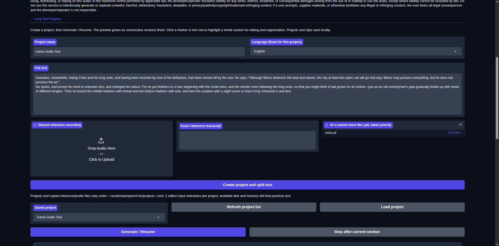
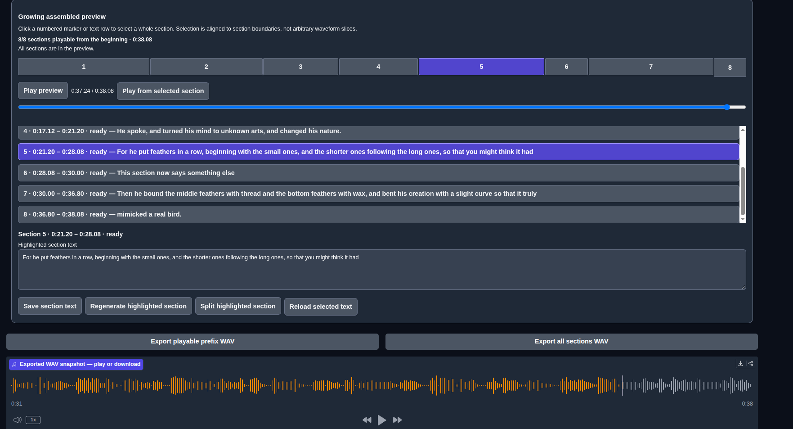

# Long-text projects / 长文本项目

The optional Base-model demo workflow splits a script into short sections, saves
each generated clip, and lets you select, edit and regenerate individual sections.
The preview grows as consecutive sections finish. The existing clone and voice-file
tabs remain available.

可选的 Base 模型演示工作流将长文本拆成短段落，逐段保存音频，并支持选择、编辑和
重新生成单个段落。连续段落完成时预览会逐步扩展。原有的克隆和音色文件选项卡保持可用。

## Run / 运行

Use Python 3.10 or newer. Install the package with Gradio 6.17 or newer for this optional interface:

```sh
pip install -e '.[long-text]'
qwen-tts-demo Qwen/Qwen3-TTS-12Hz-0.6B-Base \
  --ip 127.0.0.1 --no-share --no-flash-attn \
  --long-text-projects-dir ./tts-projects
```

Use an existing local checkpoint path instead of the model ID for offline use.
Without `--long-text-projects-dir`, the demo's existing behavior is unchanged.
The directory is explicit and portable; no machine-specific launcher, resource
watchdog or GPU allocation settings are included. When enabled, all tabs use one
shared model queue with concurrency 1. Sampling options from the demo still apply;
long-text generation uses 256 new tokens per section (nominally about 20 seconds
with the 12 Hz tokenizer), not a guaranteed speech duration.

如需离线使用，请将模型 ID 换成已有的本地检查点路径。不指定该参数时，演示行为不变。
项目目录由用户明确指定，不包含特定机器的启动器、资源监控或 GPU 配置。启用后，
所有选项卡共用并发数为 1 的模型队列。采样设置仍然生效；长文本每段最多生成
256 个新令牌（12 Hz 分词器下名义上约 20 秒），并不保证实际语音时长。

This is a trusted **single-user local demo**, not an authenticated multi-user
service. Projects, transcripts, copied references and voice profiles are shared
by browser sessions connected to that demo. Use one server process per project
directory, bind to localhost, and do not expose it using a public share link.
Only load trusted, self-created voice profiles. `.pt` files are PyTorch checkpoints;
`weights_only=True` is not a guarantee that an untrusted checkpoint is safe.
Keep PyTorch and other dependencies patched according to their official advisories.

这是可信的**单用户本地演示**，不是带身份验证的多用户服务。连接到同一演示的浏览器
会话共享项目、文本、参考音频和音色文件。每个项目目录只能由一个服务器进程使用，
请绑定本机地址，不要通过公共共享链接公开。仅加载可信且自行创建的音色文件；
`.pt` 是 PyTorch 检查点，`weights_only=True` 不能保证不可信检查点安全。
请按官方公告及时更新 PyTorch 和其他依赖。

## Workflow / 使用流程

1. Open **Long Text Projects (长文本项目)**, enter a title and script, and choose
   a language and either reference audio with its exact transcript or a trusted
   voice profile. Create the project to split and save its text.
2. **Generate / Resume (生成 / 继续)** generates sequentially and skips ready clips.
   **Stop after current section (当前段落完成后停止)** saves the current clip before stopping.
3. Click a numbered marker or text row to highlight a **whole section**. The editor
   and time range follow its stable ID. Change its text and regenerate it. Other
   clips remain unchanged. There is no arbitrary waveform slicing.
4. **Export completed audio so far (导出目前已完成的音频)** stops at the first
   unfinished section. Full export requires every section to be ready. Download
   the resulting WAV from the audio player.
5. Refresh the project list and load a saved project after restarting the demo.
   Resume retries interrupted or failed sections without regenerating ready ones.

创建项目后逐段生成；点击标记或文本行选中整个段落进行编辑和重新生成；当前段落完成后
可停止。导出目前已完成的音频会在第一个未完成段落前停止，不会跳过缺口。完整导出需要
所有段落就绪。重新启动后可刷新列表、加载项目并继续。

## Persistence and bounds / 保存与限制

- JSON manifests and immutable versioned WAV clips live in the chosen directory.
  Manifests are replaced atomically after each section. Interrupted generation is
  recoverable; edits invalidate the affected clip and any old assembled version.
- The browser plays the contiguous ready prefix as a playlist. Tail updates keep
  the current media source and position; replacing the current version pauses
  playback and restores its relative position where possible. Small transitions
  between preview clips are possible. WAV export concatenates samples continuously.
- No confirmed natural EOS means **needs review**, never silently ready. Bulk
  generation retries smaller sections at most three split levels, then stops.
  Ready confirms an EOS token, not pronunciation or word-for-word accuracy.
- Splitting is conservative and sentence-aware, not linguistic prosody analysis:
  140 characters per section (70 for detected CJK). A project accepts at most two
  million input characters; large projects may still be slow to render or cache.
- Disk reserve is 128 MiB, export is capped below 4 GB WAV, and mismatched sample
  rates/formats are rejected rather than silently resampled. There is no unlimited
  capacity promise, cross-process locking, automatic clip garbage collection or
  undo UI. Old versioned clips remain on disk; manage the project directory when
  the demo is stopped.

项目清单按段落原子保存，版本化 WAV 保持不变，支持中断恢复与过期版本检查。预览只播放
从开头连续就绪的部分，新增后续段落不会重置当前播放；当前版本被替换时暂停并尽可能
保留相对位置。未确认自然结束时标记为需要检查，批量生成最多拆分重试三层。
输入、磁盘、WAV 格式和浏览器性能均有限制；不支持无限容量、跨进程锁或自动清理旧音频。

## Validation / 验证

Offline commands, requiring no checkpoint or GPU:

```sh
python -m unittest discover -s tests/long_text -p 'test_*.py'
python tests/long_text/check_ui.py
node tests/long_text/test_preview.js
```

The 30 backend tests cover sentence splitting, ordering, interrupted recovery,
stop/resume, single-section replacement, stale revisions/exports, failed gaps,
sample-rate mismatch, truncation and disk-write failures. Twelve JavaScript checks
cover playback reconciliation and stable selection/time mapping. The Gradio check
constructs the actual bilingual demo and exercises callbacks with a stub model,
including the shared queue, stop bypass, growing preview and natural-EOS capture.
These checks do not assess actual speech quality.

A local English-only prototype of the same workflow was tested with the 0.6B Base
model: two short sections, selected-section text edit/regeneration, unchanged
other-clip hash, project reload/resume, browser playback, and byte-identical
download of a 4.08-second 24 kHz mono PCM16 export. The user subsequently completed
manual testing, including an eight-section example shown below. The bilingual
packaged patch is checked offline; it has not undergone another real-model run.

离线检查不加载模型，不评估语音质量。同一工作流的本地英文原型已完成短时真实模型与
浏览器验证，用户也已完成手动测试。打包后的双语补丁通过离线检查，但未再次运行真实模型。

This implementation and its tests were prepared with AI assistance. These results
are contributor checks and user testing, not maintainer review or upstream approval.

实现与测试使用了 AI 辅助。以上仅为贡献者检查和用户测试，不代表维护者审查或上游认可。

## User-supplied prototype screenshots / 用户提供的原型截图

These show the English-only local prototype used for manual testing. The fork's
new UI is bilingual and the prefix-export label is now **Export completed audio
so far**. Screenshots intentionally show the user's supplied test text; no audio,
voice profile, project files or personal absolute paths are included.

以下为用户手动测试时提供的本地英文原型截图。新界面为双语，导出按钮的文字已更新。
截图中包含用户提供的测试文本，但不包含音频、音色文件、项目文件或个人绝对路径。




## Fork dependency baseline / 分支依赖基线

This fork requires Torch and torchaudio >= 2.10.0 and Python >= 3.10. The
[official PyTorch advisory](https://github.com/pytorch/pytorch/security/advisories/GHSA-63cw-57p8-fm3p)
identifies CVE-2026-24747 in Torch <= 2.9.1, fixed in >= 2.10.0, including malicious
checkpoints loaded with `weights_only=True`.

The [official torchaudio compatibility table](https://docs.pytorch.org/audio/stable/installation.html)
and PyPI metadata pair Torch 2.10.0 with torchaudio 2.10.0; both provide Python 3.12
Linux x86-64 wheels. Torch 2.10.0 PyPI metadata declares CUDA 12.8 runtime packages
on Linux x86-64. This is a **metadata compatibility check**, not a driver, CUDA,
Transformers, FlashAttention or Qwen synthesis validation. The earlier real-model
prototype test used Torch 2.8.0 / torchaudio 2.8.0; it does not establish that the
patched pair works end-to-end. A fresh isolated patched-runtime smoke test is still
required before calling this draft production-ready. No live installation was
upgraded during PR preparation.

本分支要求 Torch 与 torchaudio 至少为 2.10.0，Python 至少为 3.10。官方公告指出
Torch 2.9.1 及以下版本存在 CVE-2026-24747，2.10.0 起已修复。已核对官方配对表和
软件包元数据，但尚未在修补后的运行环境中验证驱动、CUDA、Transformers、FlashAttention
或完整 Qwen 合成。早期原型使用 2.8.0，不能证明新配对的端到端兼容性。发布草稿期间未
升级正在运行的本地安装。仅加载可信、自行创建的音色文件仍然是必要的使用限制。
